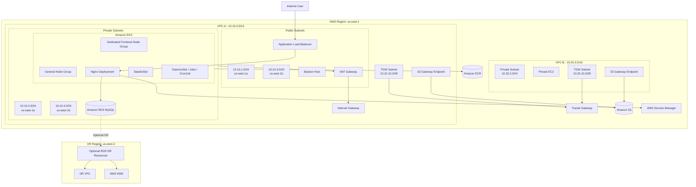

# Production-v2

Production-style AWS + Amazon EKS project that separates **AWS infrastructure**, **EKS platform add-ons**, and **Kubernetes workloads** into independent layers.

The repository is designed as a practical DevOps reference for building, deploying, operating, and troubleshooting a multi-AZ AWS/EKS environment with Terraform, Helm, Docker, and native Kubernetes YAML.

> The original `Production` repository is intentionally kept unchanged so the older implementation can be compared with this refactored `Production-v2` architecture.

---

## Table of Contents

- [Project Goals](#project-goals)
- [High-Level Architecture](#high-level-architecture)
- [Repository Structure](#repository-structure)
- [Architecture Layers](#architecture-layers)
- [Network Architecture](#network-architecture)
- [EKS Architecture](#eks-architecture)
- [EKS Managed Add-ons](#eks-managed-add-ons)
- [AWS Load Balancer Controller](#aws-load-balancer-controller)
- [Application Request Flow](#application-request-flow)
- [Kubernetes Workloads](#kubernetes-workloads)
- [Storage and Stateful Workloads](#storage-and-stateful-workloads)
- [Secrets and IRSA](#secrets-and-irsa)
- [RDS and Data Services](#rds-and-data-services)
- [Disaster Recovery Foundation](#disaster-recovery-foundation)
- [Terraform State Design](#terraform-state-design)
- [Deployment Order](#deployment-order)
- [Verification](#verification)
- [Troubleshooting Lessons](#troubleshooting-lessons)
- [Security Design](#security-design)
- [Production Improvements](#production-improvements)
- [Example Voting Application on Amazon EKS](#example-voting-application-on-amazon-eks)

---

# Project Goals

The main goal of `Production-v2` is to demonstrate a cleaner production-style separation of responsibilities.

```text
Terraform Infrastructure
        |
        v
Terraform EKS Add-ons
        |
        v
Vendor Platform Software
        |
        v
Native Kubernetes Workloads
```

The design follows these rules:

- `terraform/environments/prod/infra` manages AWS infrastructure.
- `terraform/environments/prod/addons` manages EKS add-ons and IAM/IRSA.
- Helm installs vendor software such as AWS Load Balancer Controller.
- Kubernetes YAML manages application workloads and Kubernetes-native objects.
- Terraform does not manage application Deployments, Services, Ingresses, StatefulSets, Jobs, or CronJobs.

This keeps the project easier to understand, troubleshoot, and maintain.

---

# High-Level Architecture



---

# Repository Structure

```text
Production-v2/
├── README.md
├── SETUP.md
├── .gitignore
│
├── app/
│   ├── Dockerfile
│   └── index.html
│
├── scripts/
│   ├── install-alb-controller.sh
│   ├── deploy-kubernetes.sh
│   └── verify.sh
│
├── terraform/
│   ├── modules/
│   │   ├── alb-controller-iam/
│   │   ├── bastion/
│   │   ├── ec2/
│   │   ├── ecr/
│   │   ├── eks/
│   │   ├── eks-secrets-access/
│   │   ├── iam-ec2-s3/
│   │   ├── rds/
│   │   ├── rds-dr/
│   │   ├── s3/
│   │   ├── transit-gateway/
│   │   ├── vpc/
│   │   └── vpc-endpoint/
│   │
│   └── environments/
│       └── prod/
│           ├── infra/
│           │   ├── backend.tf
│           │   ├── backend.hcl.example
│           │   ├── providers.tf
│           │   ├── variables.tf
│           │   ├── terraform.tfvars.example
│           │   ├── locals.tf
│           │   ├── network.tf
│           │   ├── compute.tf
│           │   ├── data-services.tf
│           │   ├── eks.tf
│           │   ├── access.tf
│           │   ├── ecr.tf
│           │   ├── dr.tf
│           │   └── outputs.tf
│           │
│           └── addons/
│               ├── backend.tf
│               ├── backend.hcl.example
│               ├── providers.tf
│               ├── variables.tf
│               ├── terraform.tfvars.example
│               ├── data.tf
│               ├── locals.tf
│               ├── core-addons.tf
│               ├── vpc-cni.tf
│               ├── ebs-csi.tf
│               ├── secrets-csi.tf
│               ├── metrics-server.tf
│               ├── app-secrets-irsa.tf
│               ├── alb-controller-iam.tf
│               └── outputs.tf
│
└── kubernetes/
    ├── addons/
    │   └── aws-load-balancer-controller-serviceaccount.yaml
    │
    └── prod/
        ├── 00-namespace/
        │   └── namespace.yaml
        │
        ├── 01-security/
        │   ├── serviceaccounts.yaml
        │   ├── rbac.yaml
        │   └── secret-provider-class.yaml
        │
        ├── 02-storage/
        │   └── storage-class.yaml
        │
        ├── 03-application/
        │   ├── deployment.yaml
        │   ├── service.yaml
        │   ├── ingress.yaml
        │   ├── hpa.yaml
        │   └── pdb.yaml
        │
        ├── 04-stateful/
        │   ├── headless-service.yaml
        │   └── statefulset.yaml
        │
        ├── 05-operations/
        │   ├── daemonset.yaml
        │   ├── job.yaml
        │   └── cronjob.yaml
        │
        └── 06-network-policy/
            └── network-policy.yaml
```

---

# Architecture Layers

## 1. Terraform Infrastructure Layer

Directory:

```text
terraform/environments/prod/infra
```

This layer creates the AWS infrastructure.

It manages:

- VPC-A
- VPC-B
- public and private subnets
- Internet Gateway
- NAT Gateway
- route tables
- Transit Gateway
- S3 Gateway Endpoints
- Bastion host
- private EC2 instances
- IAM roles
- Amazon ECR
- Amazon S3
- Amazon RDS MySQL
- Amazon EKS
- EKS managed node groups
- EKS OIDC provider
- EKS access
- DR foundation in `us-west-2`
- KMS resources for DR

This Terraform root intentionally uses AWS providers only for infrastructure responsibilities.

---

## 2. Terraform EKS Add-ons Layer

Directory:

```text
terraform/environments/prod/addons
```

The add-ons layer reads infrastructure outputs through Terraform remote state.

It manages:

- CoreDNS
- kube-proxy
- Amazon VPC CNI
- Amazon EBS CSI Driver
- AWS Secrets Store CSI Driver Provider
- Metrics Server
- EBS CSI IAM role
- application Secrets Manager IAM role
- AWS Load Balancer Controller IAM role and policy

Dependency flow:

```text
Infrastructure Terraform State
          |
          | outputs
          v
EKS Add-ons Terraform State
```

This makes add-ons independently manageable without mixing them into the main infrastructure state.

---

## 3. Vendor Platform Software Layer

AWS Load Balancer Controller is installed with Helm.

Script:

```text
scripts/install-alb-controller.sh
```

Terraform creates the IAM role and policy.

Helm installs the controller into:

```text
namespace: kube-system
serviceAccount: aws-load-balancer-controller
```

IRSA connects the Kubernetes ServiceAccount to the AWS IAM role.

---

## 4. Kubernetes Workload Layer

Directory:

```text
kubernetes/prod
```

Native Kubernetes YAML manages:

- Namespace
- ServiceAccounts
- RBAC
- SecretProviderClass
- StorageClass
- Deployment
- Service
- Ingress
- HPA
- PDB
- StatefulSet
- Headless Service
- DaemonSet
- Job
- CronJob
- NetworkPolicy

---

# Network Architecture

## VPC-A

Primary application VPC:

```text
CIDR: 10.10.0.0/16
```

| Subnet | CIDR | AZ | Purpose |
|---|---|---|---|
| Public Subnet 1 | `10.10.1.0/24` | `us-east-1a` | Public networking / ALB / NAT |
| Public Subnet 2 | `10.10.3.0/24` | `us-east-1b` | Multi-AZ ALB |
| Private Subnet 1 | `10.10.2.0/24` | `us-east-1a` | EKS private workloads |
| Private Subnet 2 | `10.10.4.0/24` | `us-east-1b` | EKS private workloads |
| TGW Subnet | `10.10.10.0/28` | `us-east-1a` | Transit Gateway attachment |

Public subnets are tagged:

```text
kubernetes.io/role/elb = 1
```

Private subnets are tagged:

```text
kubernetes.io/role/internal-elb = 1
```

These tags allow AWS Load Balancer Controller to discover appropriate subnets.

---

## VPC-B

Secondary private VPC:

```text
CIDR: 10.20.0.0/16
```

It contains:

- private EC2 workload
- private subnet
- Transit Gateway subnet
- S3 Gateway Endpoint

VPC-A and VPC-B communicate through AWS Transit Gateway.

```text
VPC-A
  |
  | TGW attachment
  v
Transit Gateway
  ^
  | TGW attachment
  |
VPC-B
```

---

## Internet Access

Public resources use the Internet Gateway.

Private workloads use:

```text
Private Subnet
      |
      v
Private Route Table
      |
      v
NAT Gateway
      |
      v
Internet Gateway
      |
      v
Internet
```

The lab currently uses a shared NAT Gateway.

For stricter production high availability, use one NAT Gateway per AZ with AZ-specific private route tables.

---

# EKS Architecture

Cluster:

```text
production-eks-cluster
```

EKS worker nodes run in VPC-A private subnets.

## General-Purpose Node Group

Current configuration:

```text
Instance Type: t3.small
Min Size:      2
Desired Size:  3
Max Size:      4
Capacity Type: ON_DEMAND
```

This node group is used for:

- Kubernetes system components
- StatefulSet workloads
- Jobs
- CronJobs
- DaemonSets
- other general workloads

---

## Dedicated Frontend Node Group

Current configuration:

```text
Instance Type: t3.small
Min Size:      1
Desired Size:  1
Max Size:      2
```

Labels:

```text
workload=frontend
environment=production
```

Taint:

```text
dedicated=frontend:NoSchedule
```

The nginx Deployment uses matching node affinity and toleration.

```text
Nginx Pods
   |
   v
nodeAffinity: workload=frontend
   |
   v
toleration: dedicated=frontend
   |
   v
Dedicated Frontend Node
```

This demonstrates workload isolation.

---

# EKS Managed Add-ons

Terraform manages these EKS add-ons:

| Add-on | Purpose |
|---|---|
| VPC CNI | Pod networking and VPC IP allocation |
| CoreDNS | Kubernetes DNS |
| kube-proxy | Kubernetes Service networking |
| EBS CSI Driver | Dynamic EBS persistent volumes |
| Secrets Store CSI Provider | AWS Secrets Manager integration |
| Metrics Server | CPU and memory metrics |

The add-on versions are pinned in Terraform for reproducibility.

---

# AWS Load Balancer Controller

The AWS Load Balancer Controller watches Kubernetes Ingress resources and provisions AWS load balancers.

Flow:

```text
Ingress YAML
    |
    v
AWS Load Balancer Controller
    |
    v
AWS ALB
    |
    v
Target Group
    |
    v
Kubernetes Pod IPs
```

The project uses:

```text
Scheme:      internet-facing
Target Type: ip
Listener:    HTTP 80
Health Path: /
IngressClass: alb
```

The controller IAM permissions are created through Terraform and accessed with IRSA.

---

# Application Request Flow

Main request path:

```text
Internet User
      |
      v
AWS Application Load Balancer
      |
      v
Kubernetes Ingress
      |
      v
ClusterIP Service: nginx-service
      |
      v
Nginx Deployment
      |
      +--> Pod 1
      +--> Pod 2
      +--> Pod 3
```

The Ingress uses:

```yaml
ingressClassName: alb
```

and:

```text
alb.ingress.kubernetes.io/scheme: internet-facing
alb.ingress.kubernetes.io/target-type: ip
```

With `target-type: ip`, the ALB registers Pod IP addresses directly in the target group.

---

# Kubernetes Workloads

## Nginx Deployment

The application Deployment uses:

```text
Replicas: 3
Strategy: RollingUpdate
```

It includes:

- CPU requests
- memory requests
- CPU limits
- memory limits
- readiness probe
- liveness probe
- node affinity
- pod anti-affinity
- frontend toleration
- Secrets Store CSI volume

---

## ClusterIP Service

```text
nginx-service
```

The Service provides a stable Kubernetes endpoint in front of the nginx Pods.

```text
Ingress
   |
   v
nginx-service
   |
   v
Nginx Pods
```

---

## Horizontal Pod Autoscaler

The application uses HPA:

```text
Minimum Pods: 3
Maximum Pods: 6
CPU Target:   60%
```

Metrics Server supplies resource metrics.

Useful commands:

```bash
kubectl get hpa -n production
kubectl top pods -n production
kubectl top nodes
```

---

## Pod Disruption Budget

The application uses a PDB to protect availability during voluntary disruptions.

```text
minAvailable: 2
```

With three nginx replicas, Kubernetes attempts to keep at least two Pods available during operations such as node draining.

---

## DaemonSet

`node-observer` demonstrates one Pod per eligible Kubernetes node.

Typical real-world uses include:

- log agents
- monitoring agents
- security agents
- node collectors

---

## Job

`nginx-smoke-test` performs a one-time connectivity check:

```text
Job
 |
 v
wget http://nginx-service
 |
 v
Application Service
```

---

## CronJob

`nginx-health-check` runs periodically:

```text
*/15 * * * *
```

It validates Service connectivity on a schedule.

---

# Storage and Stateful Workloads

## EBS StorageClass

The project uses EBS CSI with:

```text
Provisioner: ebs.csi.aws.com
Volume Type: gp3
Encrypted:   true
Binding:     WaitForFirstConsumer
```

`WaitForFirstConsumer` ensures the EBS volume is created after Kubernetes has selected an appropriate node topology.

---

## StatefulSet

The StatefulSet demonstrates:

- stable Pod identities
- Headless Service
- persistent storage
- per-Pod PVCs
- EBS-backed persistence

Example:

```text
stateful-web-0
   |
   v
web-data-stateful-web-0
   |
   v
EBS Volume

stateful-web-1
   |
   v
web-data-stateful-web-1
   |
   v
EBS Volume
```

Amazon EBS volumes are Availability-Zone specific.

A Pod must therefore run on a node in the same AZ as its EBS volume.

---

# Secrets and IRSA

The database password is not stored in Git.

RDS uses AWS Secrets Manager for its master credentials.

Application secret flow:

```text
AWS Secrets Manager
        |
        v
Secrets Store CSI Driver
        |
        v
SecretProviderClass
        |
        v
Mounted read-only secret volume
        |
        v
Application Pod
```

The application ServiceAccount uses an IRSA role with permission only to the required secret.

---

## IRSA Relationships

```text
EBS CSI ServiceAccount
      |
      v
EBS CSI IAM Role

AWS Load Balancer Controller ServiceAccount
      |
      v
ALB Controller IAM Role

production-app ServiceAccount
      |
      v
App Secrets IAM Role
```

The EKS OIDC provider enables these trust relationships.

---

# RDS and Data Services

## Amazon RDS

The project uses RDS MySQL in private subnets.

Key design points:

- DB subnet group across private subnets
- security group-controlled access
- Secrets Manager master credentials
- private networking
- Terraform-managed configuration
- parameter group support
- backup configuration

The lab uses cost-conscious defaults.

For a stricter production environment, consider:

- Multi-AZ
- deletion protection
- longer backup retention
- enhanced monitoring
- Performance Insights
- automated DR

---

## Amazon S3

S3 is used for application/lab data.

S3 Gateway Endpoints allow private VPC resources to access S3 without using public internet routing.

---

## Amazon ECR

Application container images are stored in Amazon ECR.

Flow:

```text
Docker Build
     |
     v
Amazon ECR
     |
     v
EKS Image Pull
     |
     v
Application Pod
```

---

# Disaster Recovery Foundation

The repository includes an optional DR foundation in:

```text
us-west-2
```

It supports future RDS disaster recovery features.

The DR layer includes:

- DR VPC
- private subnets
- RDS DR networking
- security controls
- KMS key

Optional Terraform flags can enable additional DR resources such as:

- cross-region read replica
- cross-region backups
- snapshot workflows
- Performance Insights

These are disabled by default to control lab cost.

---

# Terraform State Design

The repository uses separate Terraform state files.

## Infrastructure State

```text
production-v2/infra/terraform.tfstate
```

Contains AWS infrastructure state.

## Add-ons State

```text
production-v2/addons/terraform.tfstate
```

Contains EKS platform add-ons and IAM/IRSA state.

The add-ons layer reads infrastructure outputs with:

```hcl
data "terraform_remote_state" "infra"
```

Dependency:

```text
Infra State
    |
    | cluster name
    | VPC ID
    | OIDC provider
    | RDS secret ARN
    v
Add-ons Layer
```

The S3 backend uses native Terraform locking:

```hcl
use_lockfile = true
```

---

# Git and Sensitive Files

The repository intentionally ignores sensitive/local Terraform files.

Do not commit:

```text
backend.hcl
terraform.tfvars
*.tfstate
*.tfstate.*
tfplan
.terraform/
.env
*.pem
*.key
```

Commit:

```text
*.tf
*.example
.terraform.lock.hcl
Kubernetes YAML
scripts
README.md
SETUP.md
```

Never commit AWS access keys, database credentials, private keys, or secret values.

---

# Deployment Order

The recommended build order is:

```text
1. Clone Repository
        |
        v
2. Configure Terraform Infra
        |
        v
3. Apply AWS Infrastructure
        |
        v
4. Configure kubectl
        |
        v
5. Apply EKS Add-ons
        |
        v
6. Install AWS Load Balancer Controller
        |
        v
7. Build + Push Docker Image to ECR
        |
        v
8. Deploy Kubernetes YAML
        |
        v
9. Verify Application
        |
        v
10. Apply NetworkPolicy
```

---

## 1. Clone

```bash
git clone https://github.com/SubhamPanwarr/Production-v2.git
cd Production-v2
```

---

## 2. Infrastructure Terraform

```bash
cd terraform/environments/prod/infra

cp backend.hcl.example backend.hcl
cp terraform.tfvars.example terraform.tfvars
```

Initialize:

```bash
terraform init -backend-config=backend.hcl
```

Validate:

```bash
terraform fmt -recursive
terraform validate
```

Plan:

```bash
terraform plan -out=tfplan
```

Apply:

```bash
terraform apply tfplan
```

---

## 3. Configure kubectl

```bash
aws eks update-kubeconfig \
  --region us-east-1 \
  --name production-eks-cluster
```

Verify:

```bash
kubectl get nodes -o wide
```

---

## 4. EKS Add-ons Terraform

```bash
cd ../addons

cp backend.hcl.example backend.hcl
cp terraform.tfvars.example terraform.tfvars
```

Initialize:

```bash
terraform init -backend-config=backend.hcl
```

Validate and plan:

```bash
terraform fmt -recursive
terraform validate
terraform plan -out=tfplan
```

Apply:

```bash
terraform apply tfplan
```

Verify:

```bash
aws eks list-addons \
  --cluster-name production-eks-cluster \
  --region us-east-1 \
  --output table
```

---

## 5. Install AWS Load Balancer Controller

From repository root:

```bash
cd ~/Production-v2
```

Update Helm:

```bash
helm repo add eks https://aws.github.io/eks-charts --force-update
helm repo update
```

List available chart versions:

```bash
helm search repo eks/aws-load-balancer-controller --versions | head
```

Set a tested version:

```bash
export AWS_LBC_CHART_VERSION="3.6.1"
export AWS_REGION="us-east-1"
```

Install:

```bash
chmod +x scripts/install-alb-controller.sh
./scripts/install-alb-controller.sh
```

Verify:

```bash
kubectl get deployment aws-load-balancer-controller -n kube-system

kubectl get pods \
  -n kube-system \
  -l app.kubernetes.io/name=aws-load-balancer-controller
```

---

## 6. Build and Push Application Image

Get ECR URL:

```bash
export ECR_REPOSITORY_URL=$(
  terraform -chdir=terraform/environments/prod/infra \
  output -raw ecr_repository_url
)

export IMAGE_TAG=v2
```

Login:

```bash
aws ecr get-login-password \
  --region us-east-1 \
  | docker login \
      --username AWS \
      --password-stdin \
      "$(echo "$ECR_REPOSITORY_URL" | cut -d/ -f1)"
```

Build:

```bash
docker build \
  -t production-app:$IMAGE_TAG \
  app/
```

Tag:

```bash
docker tag \
  production-app:$IMAGE_TAG \
  "$ECR_REPOSITORY_URL:$IMAGE_TAG"
```

Push:

```bash
docker push "$ECR_REPOSITORY_URL:$IMAGE_TAG"
```

---

## 7. Deploy Kubernetes Resources

```bash
chmod +x scripts/deploy-kubernetes.sh scripts/verify.sh

IMAGE_TAG=v2 ./scripts/deploy-kubernetes.sh
```

The deployment script applies:

```text
00-namespace
01-security
02-storage
03-application
04-stateful
05-operations
```

NetworkPolicy is intentionally applied later.

---

# Verification

## Cluster

```bash
kubectl get nodes -o wide
kubectl get nodes -L topology.kubernetes.io/zone,workload
```

## Workloads

```bash
kubectl get all -n production
kubectl get pods -n production -o wide
```

## Storage

```bash
kubectl get pvc -n production
kubectl get pv
```

## HPA

```bash
kubectl get hpa -n production
kubectl top pods -n production
kubectl top nodes
```

## ALB

```bash
kubectl get ingress -n production
```

Get DNS name:

```bash
ALB_DNS=$(kubectl get ingress production-app-ingress \
  -n production \
  -o jsonpath='{.status.loadBalancer.ingress[0].hostname}')

echo "$ALB_DNS"
```

Test:

```bash
curl -I "http://$ALB_DNS"
curl "http://$ALB_DNS"
```

Expected:

```text
HTTP/1.1 200 OK
```

---

# NetworkPolicy

The NetworkPolicy is intentionally applied after the application is healthy.

Current policy:

- selects nginx Pods
- allows TCP port 80
- allows ingress from VPC-A CIDR `10.10.0.0/16`

Apply:

```bash
kubectl apply \
  -f kubernetes/prod/06-network-policy/network-policy.yaml
```

Verify:

```bash
kubectl get networkpolicy -n production
```

Retest the ALB afterward.

---

# Troubleshooting Lessons

This project intentionally includes real troubleshooting scenarios encountered during deployment.

## 1. ALB Could Not Discover Subnets

Symptom:

```text
FailedBuildModel
couldn't auto-discover subnets
```

Checks:

```bash
aws ec2 describe-subnets \
  --filters \
    "Name=vpc-id,Values=<vpc-id>" \
    "Name=tag:kubernetes.io/role/elb,Values=1"
```

Also verify controller configuration:

```bash
kubectl get deployment aws-load-balancer-controller \
  -n kube-system \
  -o jsonpath='{.spec.template.spec.containers[0].args}'
```

Important lesson:

The controller region must match the EKS cluster region.

---

## 2. Pod Pending - Too Many Pods

Symptom:

```text
Too many pods
```

Check allocatable Pod count:

```bash
kubectl get nodes \
  -o custom-columns='NODE:.metadata.name,ALLOCATABLE-PODS:.status.allocatable.pods'
```

Count Pods per node:

```bash
for NODE in $(kubectl get nodes -o jsonpath='{.items[*].metadata.name}'); do
  echo "===== $NODE ====="

  kubectl get pods -A \
    --field-selector spec.nodeName="$NODE" \
    --no-headers | wc -l
done
```

Small EKS instances can hit Pod density limits quickly when platform DaemonSets are installed.

---

## 3. EC2 vCPU Quota

The general node group was scaled to:

```text
desired_size = 3
```

but a new node could not initially launch because the account had an 8-vCPU Standard On-Demand quota.

Check quota:

```bash
aws service-quotas get-service-quota \
  --service-code ec2 \
  --quota-code L-1216C47A \
  --region us-east-1
```

A practical production/lab lesson:

Always validate EC2 service quotas before scaling EKS node groups.

Current planned compute:

```text
3 x general t3.small  = 6 vCPU
1 x frontend t3.small = 2 vCPU
1 x bastion t3.micro  = 2 vCPU
--------------------------------
Total                 = 10 vCPU
```

Request enough quota headroom before running all resources simultaneously.

---

## 4. StatefulSet Pending Due to EBS AZ Affinity

Symptom:

```text
node(s) didn't match PersistentVolume's node affinity
```

Amazon EBS volumes are AZ-specific.

Find PVC:

```bash
kubectl get pvc -n production -o wide
```

Find PV:

```bash
PV=$(kubectl get pvc <pvc-name> \
  -n production \
  -o jsonpath='{.spec.volumeName}')
```

Check required AZ:

```bash
kubectl get pv "$PV" \
  -o jsonpath='{.spec.nodeAffinity.required.nodeSelectorTerms[*].matchExpressions[*].values}{"\n"}'
```

Compare node AZs:

```bash
kubectl get nodes \
  -L topology.kubernetes.io/zone,workload
```

---

## 5. CNI IP Assignment

Possible symptom:

```text
failed to assign an IP address to container
```

Useful checks:

```bash
kubectl get pods -n kube-system -l k8s-app=aws-node
kubectl logs -n kube-system <aws-node-pod>
```

Also verify:

- subnet free IP addresses
- VPC CNI health
- node Pod density
- EC2 ENI/IP limits

---

# Security Design

The repository demonstrates:

- EKS worker nodes in private subnets
- RDS in private subnets
- security-group-controlled access
- IAM roles instead of static application credentials
- IRSA
- AWS Secrets Manager
- encrypted EBS volumes
- KMS for DR resources
- S3 Gateway Endpoints
- Kubernetes RBAC
- NetworkPolicy
- tainted dedicated node group
- remote Terraform state
- sensitive local Terraform configuration excluded from Git

---

# Production Improvements

This project balances production patterns with lab cost.

For a stricter production implementation, consider:

- one NAT Gateway per AZ
- separate private route tables per AZ
- larger EKS instance types
- custom networking / prefix delegation where appropriate
- Cluster Autoscaler or Karpenter
- higher EC2 service quotas
- Multi-AZ RDS
- deletion protection
- longer backup retention
- HTTPS with ACM
- Route 53
- AWS WAF
- ExternalDNS
- Prometheus + Grafana
- CloudWatch Container Insights
- centralized logging
- Trivy image scanning
- CI/CD with Jenkins or GitHub Actions
- admission policies
- Pod Security Standards
- ECR lifecycle policies
- AWS Backup
- automated multi-region DR

---

# Quick Architecture Summary

```text
GitHub
  |
  +--> Terraform Infrastructure
  |       |
  |       +--> VPC-A / VPC-B
  |       +--> Transit Gateway
  |       +--> Bastion / EC2
  |       +--> EKS
  |       +--> RDS
  |       +--> ECR
  |       +--> S3
  |       +--> DR Foundation
  |
  +--> Terraform EKS Add-ons
  |       |
  |       +--> VPC CNI
  |       +--> CoreDNS
  |       +--> kube-proxy
  |       +--> EBS CSI
  |       +--> Secrets Store CSI
  |       +--> Metrics Server
  |       +--> IAM / IRSA
  |
  +--> Helm
  |       |
  |       +--> AWS Load Balancer Controller
  |
  +--> Kubernetes YAML
          |
          +--> Namespace
          +--> RBAC
          +--> ServiceAccounts
          +--> Deployment
          +--> Service
          +--> Ingress
          +--> HPA
          +--> PDB
          +--> StatefulSet
          +--> DaemonSet
          +--> Job
          +--> CronJob
          +--> NetworkPolicy
```

Final application traffic flow:

```text
Internet User
      |
      v
AWS ALB
      |
      v
Kubernetes Ingress
      |
      v
ClusterIP Service
      |
      v
Nginx Pods
      |
      +--> AWS Secrets Manager via CSI + IRSA
      |
      +--> RDS MySQL
```

Persistent workload flow:

```text
StatefulSet
   |
   v
PVC
   |
   v
EBS CSI Driver
   |
   v
Encrypted gp3 EBS Volume
```

`Production-v2` provides a practical end-to-end reference for deploying and troubleshooting AWS infrastructure, Amazon EKS, platform add-ons, Kubernetes networking, storage, security, scaling, and application delivery.

---

## Example Voting Application on Amazon EKS

The [Docker Example Voting App](https://github.com/dockersamples/example-voting-app) is deployed on EKS as a multi-container training workload, separate from the Nginx platform lab documented earlier.

**Tested lab milestone (28 October 2026):** Vote and Result applications were exposed through public AWS ALBs, three Blue and three Green Vote replicas were healthy, and the Vote ALB successfully served **Blue → Green → Blue (rollback) → Green** using a Service selector. This describes the lab at the time of testing, not a continuous uptime guarantee.

### Application architecture

```text
Internet
  |----> Vote ALB ---> vote Ingress ---> vote Service ---> active Vote pods
  |                                                        |
  |                                                        v
  |                                                      Redis
  |                                                        |
  |                                                        v
  |                                                     Worker
  |                                                        |
  |                                                        v
  |                                                    PostgreSQL
  |
  +----> Result ALB ---> result Ingress ---> result Service ---> Result pods
                                                             |
                                                             +-- read PostgreSQL
```

Both ingresses use AWS Load Balancer Controller (`ingressClassName: alb`) with internet-facing ALBs and `alb.ingress.kubernetes.io/target-type: ip`, so the target groups register Pod IPs. Both public endpoints returned HTTP 200 in testing. The application components share Redis, Worker and PostgreSQL; **Blue-Green applies to the Vote frontend**, not two isolated full stacks.

| Component | Tested replicas | Role |
| --- | ---: | --- |
| Vote (Blue) | 3 | Existing frontend, retained for rollback |
| Vote (Green) | 3 | Updated frontend, active after final cutover |
| Result | 3 | Live voting results |
| Redis | 1 | Vote queue |
| Worker | 1 | Reads votes from Redis, writes PostgreSQL |
| PostgreSQL | 1 | Voting database; lab-only ephemeral storage |

### Repository layout

- `application/voting-app/` — application source and Dockerfiles
- `kubernetes/voting-app/base/` — Deployments and Services
- `kubernetes/voting-app/bluegreen/vote-green-deployment.yaml` — Green Deployment
- `kubernetes/voting-app/bluegreen/vote-green-preview-service.yaml` — Green preview Service (created in local workspace)
- `kubernetes/voting-app/ingress/` — Vote and Result public ALB Ingress manifests
- `terraform/environments/prod/addons/` — EKS add-ons and IAM/IRSA
- `scripts/install-alb-controller.sh` — Helm install for the AWS Load Balancer Controller

### Rolling update and troubleshooting

The original `vote-v1` image used the Dockerfile's development stage and expected a local Docker Compose bind mount. In EKS, `/usr/local/app/app.py` was missing and the Pods entered `CrashLoopBackOff`. Building the Dockerfile's `final` stage, pushing `production-app:vote-v2` to ECR and updating the Vote Deployment resolved the problem. Kubernetes created a new ReplicaSet and finished its rolling update. Result and Worker images used tags `result-v1` and `worker-v1`.

```bash
kubectl logs -n voting-app deployment/vote
kubectl rollout status deployment/vote -n voting-app
kubectl rollout history deployment/vote -n voting-app
kubectl get replicasets -n voting-app
```

### Blue-Green deployment — cutover and rollback verified

The `vote` Deployment has three Pods labelled `slot: blue`; the `vote-green` Deployment has three Pods labelled `slot: green`. Both use the working Vote image, but Green sets `OPTION_A=GREEN - Cats` and `OPTION_B=GREEN - Dogs` for easy visual identification. Future releases should use distinct, immutable image digests.

The production Service `vote` routes traffic to whichever `slot` its selector specifies. The existing public ALB Ingress remains unchanged, and Blue stays running for rollback.

**Verify Deployments and selectors:**

```bash
kubectl get deployments -n voting-app
kubectl get pods -n voting-app -l app=vote -L slot -o wide
kubectl get svc vote -n voting-app -o jsonpath='{.spec.selector}{"\n"}'
```

**Preview Green before changing production traffic:**

```bash
kubectl get endpointslices -n voting-app -l kubernetes.io/service-name=vote-green-preview
kubectl port-forward -n voting-app svc/vote-green-preview 8090:80
# From a separate terminal: curl http://localhost:8090
```

**Cut over Blue → Green:**

```bash
kubectl patch svc vote -n voting-app --type=merge \
  -p '{"spec":{"selector":{"app":"vote","slot":"green"}}}'

kubectl get endpointslices -n voting-app -l kubernetes.io/service-name=vote
VOTE_ALB=$(kubectl get ingress vote-ingress -n voting-app \
  -o jsonpath='{.status.loadBalancer.ingress[0].hostname}')
curl -s "http://$VOTE_ALB" | grep GREEN
```

**Roll back Green → Blue:**

```bash
kubectl patch svc vote -n voting-app --type=merge \
  -p '{"spec":{"selector":{"app":"vote","slot":"blue"}}}'
curl -s "http://$VOTE_ALB" | grep -E 'Cats|Dogs'
```

The rollback returned the original Cats/Dogs page via the same public ALB. The lab subsequently switched back to Green. **ALB target registration, deregistration and health checks are asynchronous, so this cutover method does not guarantee zero downtime.** Inspect target health before declaring success in a production environment.

### Scheduling / node-capacity lessons

The three general-purpose `t3.small` nodes hit their 11-Pod limits. Green could not fully schedule because the remaining frontend node was tainted `dedicated=frontend:NoSchedule`. Applying the following toleration resolved the pending Pods and rollout deadline:

```yaml
tolerations:
  - key: dedicated
    operator: Equal
    value: frontend
    effect: NoSchedule
```

All three Green Pods are currently placed on one node, a **single point of failure**. This cost-conscious lab demonstrates scheduling and tolerations, but a production deployment needs enough node capacity and cross-node / multi-AZ placement. Other observed issues: CNI IP assignment errors, `Too many pods`, `ProgressDeadlineExceeded`, and ALB target registration.

### Security and production caveats

- PostgreSQL uses ephemeral storage: use durable persistent storage or managed PostgreSQL before production.
- Never commit the lab's `kubernetes/voting-app/base/postgres-secret.yaml` or actual credentials.
- Public ALBs use HTTP in the lab; use HTTPS with ACM, appropriate DNS and security controls in production.
- This is frontend Blue-Green; Blue and Green share the same Redis, Worker and PostgreSQL services.
- The local WSL manifests may be newer than the GitHub `main` branch. Before pushing, ensure `base/vote-deployment.yaml` has the `slot: blue` **Pod template** label (preserve the immutable Deployment selector `app: vote`), `base/vote-service.yaml` selects the intended active `slot: green`, and the preview Service YAML is included. The README update alone does not deploy workloads or commit those files.

### Next milestones

1. Canary traffic splitting using AWS ALB weighted target groups, verification and rollback.
2. Jenkins CI/CD with SonarQube quality gates, image building, scanning and ECR push.
3. Deployment automation supporting Rolling, Blue-Green and Canary with approvals.
4. More resilient Pod placement, persistent database storage, secrets management, HTTPS and monitoring.
